# Cairn

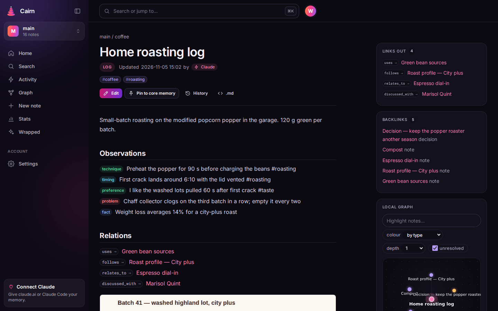

Cairn is long-term memory for AI assistants that you run on your own Cloudflare account. Your
memory is a set of markdown notes with typed observations (`- [decision] …`), relations
(`- depends_on [[Other note]]`) and tags. Claude and other MCP clients read and write them over
OAuth; you browse, edit, search and export them in a web app. Search uses keywords and meaning
together, and every write returns a receipt saying what was saved, where and by which app.

It is one Cloudflare Worker: passkey sign-in (no passwords, no email), room for several people,
one SQLite Durable Object per project, and an export that hands back exactly the markdown you
wrote. The note format and tool behaviour follow [Basic Memory](https://github.com/basicmachines-co/basic-memory),
so Basic Memory projects and Obsidian vaults import as they are, and the export drops back into
either.

*(The landing page calls it a revolutionary emotionally intelligent recall paradigm. It is a
notes database with good manners.)*

## Contents

[Features](#features) · [Screenshots](#screenshots) · [Deploy your own](#deploy-your-own) ·
[Connect Claude](#connect-claude-and-other-assistants) · [Files](#files) · [Sharing a project](#sharing-a-project) · [Deploy from GitHub Actions](#deploy-from-github-actions) ·
[Costs and limits](#costs-and-limits) · [Security](#security) · [Backups and export](#backups-and-export) ·
[Upgrading](#upgrading) · [Troubleshooting](#troubleshooting) · [Development](#development) ·
[Licence](#licence)

## Features

**Memory and tools.** A remote MCP server at `/mcp` (streamable HTTP, OAuth 2.1 with PKCE,
dynamic client registration and client ID metadata documents, or a personal access token), with
these tools:

| Tool | What it does |
|---|---|
| `write_note` | Create or replace a note (by path, or title + folder); returns a receipt and write hints. `source_text` keeps the verbatim words it came from beside it (searchable, secrets redacted) |
| `read_note` | Read by permalink, `memory://` URL, path or title; a section, line range or token budget; `sources=true` adds the kept original text |
| `edit_note` | Append, prepend, find/replace, replace or insert around a section, set frontmatter; checksum-guarded |
| `delete_note` | Delete a note, or a folder with `recursive` (the text stays in history) |
| `move_note` | Move or rename a note or folder; permalinks stay, so links keep resolving |
| `search_notes` | Hybrid search with tags, types, folders, frontmatter filters, observation categories, dates and paging |
| `find_notes` | Recursive find by file-name glob or frontmatter, with the fields you choose |
| `list_notes` | One folder level |
| `build_context` | A note and its linked notes in both directions, to a depth you choose |
| `recent_activity` | What changed lately, and which app changed it; `items=["miss"]` lists the questions your notes didn't answer |
| `log_miss` | Record a question the notes didn't answer (empty searches are recorded automatically); review them at `/app/misses` |
| `projects` | List or create projects (up to 20 per person) |
| `core_memory` | The always-loaded memory: an index note plus every `pinned: true` note, within a byte budget (also a prompt) |
| `supersede` | Replace a fact without losing it: the old one moves under `## Superseded`, dated |
| `attach_file` | Attach a file (URL, base64 or an upload URL) to a note; Cairn reads its text |
| `check_schema` | Validate notes against [Picoschema](https://github.com/basicmachines-co/basic-memory) schemas, infer one, or show drift (`SCHEMA_ENABLED`) |
| `help` | The manual, generated from the tools' own schemas |

Every Basic Memory parameter is honoured or refused with a typed `INVALID` error, never silently
ignored. Set `BM_COMPAT=true` to also register Basic Memory's `bm_*` tool names, so skills
written for Basic Memory run unchanged.

**Around the notes.**

- Hybrid search: SQLite FTS5 fused with Workers AI embeddings in Vectorize. The top results are
  re-ranked by Jev, a small judgement model, which also says when nothing matches well. It falls
  back to keyword-only search without those bindings.
- Write hints: likely duplicates, conflicting facts and unresolved links come back with the
  receipt.
- Supersession and expiry: `(expires 2027-01-01)` facts retire themselves nightly. They are
  moved, never deleted.
- History for every note, with line diffs, one-click undo, and "undo everything app X did since T".
- Nightly gardening (opt-out): a checklist note of contradictions, orphans, unresolved links,
  near-duplicates and stale notes. A weekly digest on Mondays. Neither edits your notes.
- Web app: search as you type, a Ctrl/Cmd-K palette, a CodeMirror editor with `[[` completion,
  a link graph, GitHub-flavoured markdown with code highlighting, mermaid, callouts and footnotes,
  and light and dark themes.
- Capture: drag, paste or attach files (stored in R2; images get an AI caption so search finds
  them), a bookmarklet clipper, sharing from a phone (installable web app), and email in
  (optional).
- Import a Basic Memory project or Obsidian vault (.zip), keeping Basic Memory's permalinks and
  rewriting links to images and files. Export everything as a zip at any time.
- Accounts: passkeys, recovery codes, open or invite-only sign-up, invite links, admins who can
  disable accounts but cannot read anyone's notes, and deleting your own account (everything,
  vectors included).
- Agent skills (`cairn-notes`, `cairn-continue`, `cairn-capture`, `cairn-gardening`,
  `cairn-tasks`), served by your instance and packaged as a Claude Code plugin.

## Screenshots

All data below is an invented demo account on the public instance, deleted after the shots.

**A note** (also at the top of this page): typed observations, relations, backlinks, a local
graph and an attached image; the byline names the app that last wrote it. Here, a decision
note in the light theme.
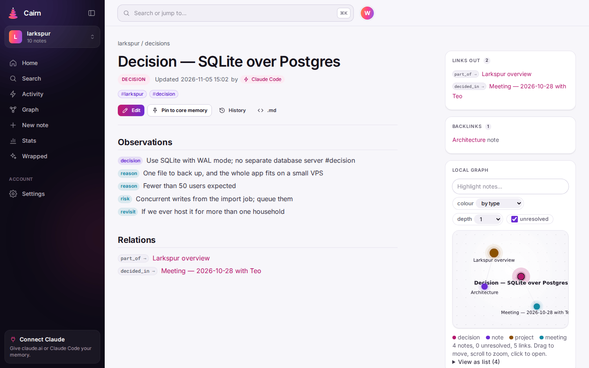

**Search** by keyword and meaning, with project, type, tag, folder and date filters.
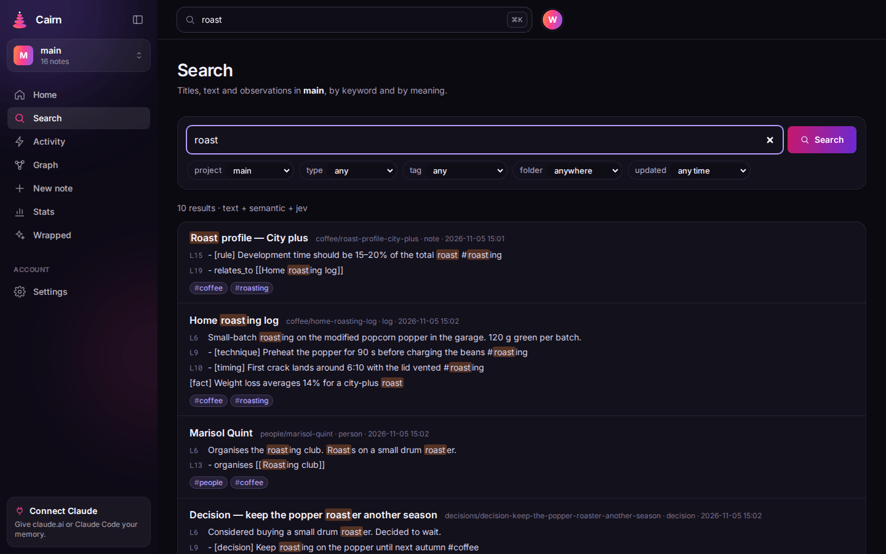

**The Ctrl/Cmd-K palette:** jump to a note, search, or start a new one.
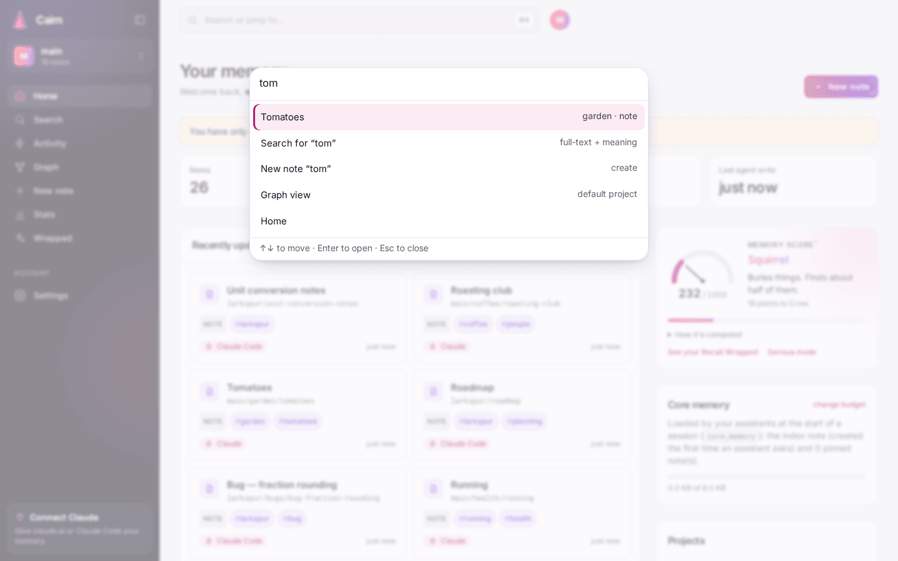

**The editor:** `[[` completes note titles, with a live preview beside it.
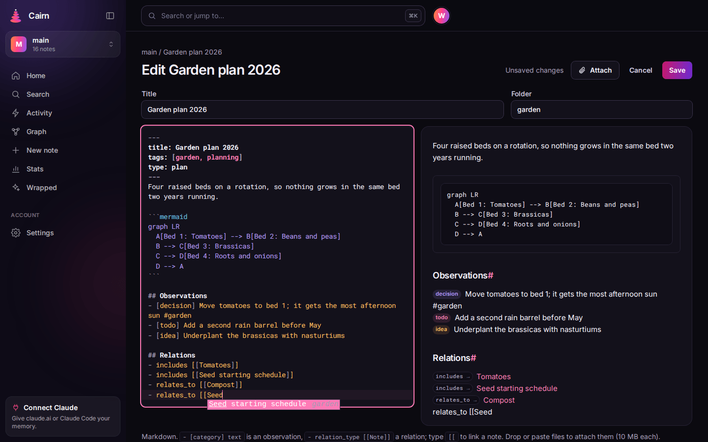

**The project graph.**
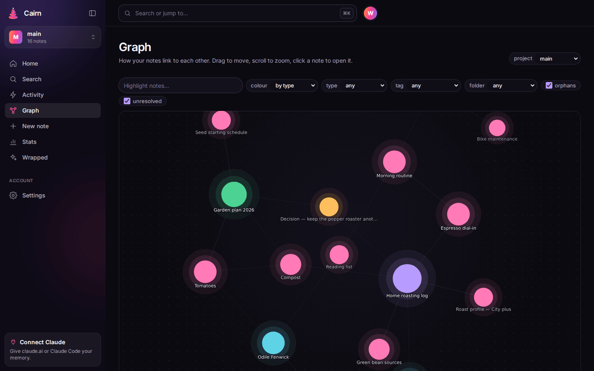

**Activity:** every change, with the app that made it (Claude Code, claude.ai) and the tool it used.
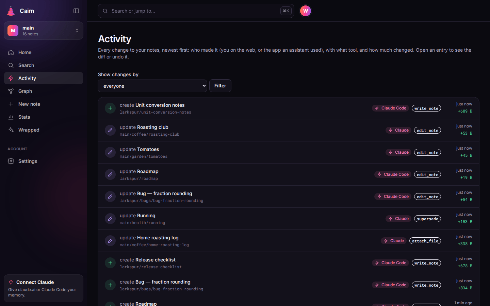

**History and undo:** each revision's diff, and a button to undo it.
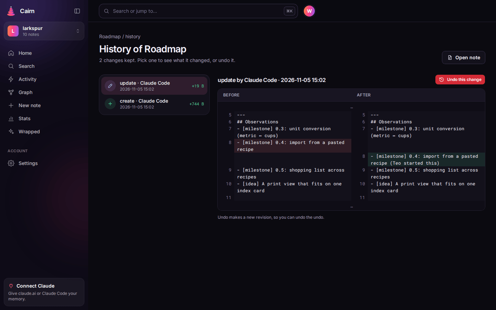

**The consent page** an assistant sends you to when it connects.
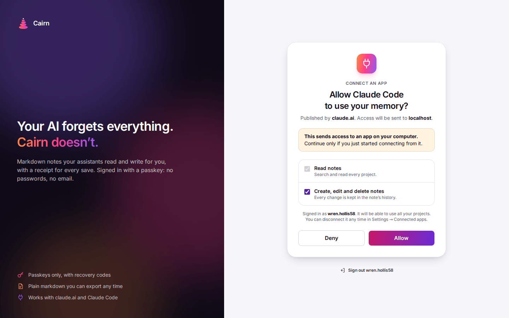

**Settings:** connected apps and personal access tokens.
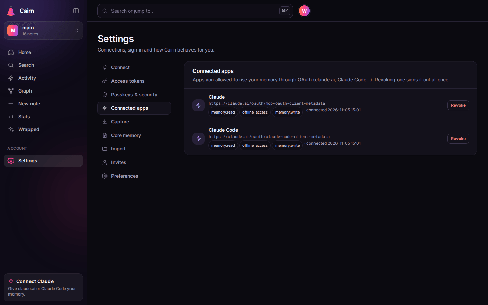
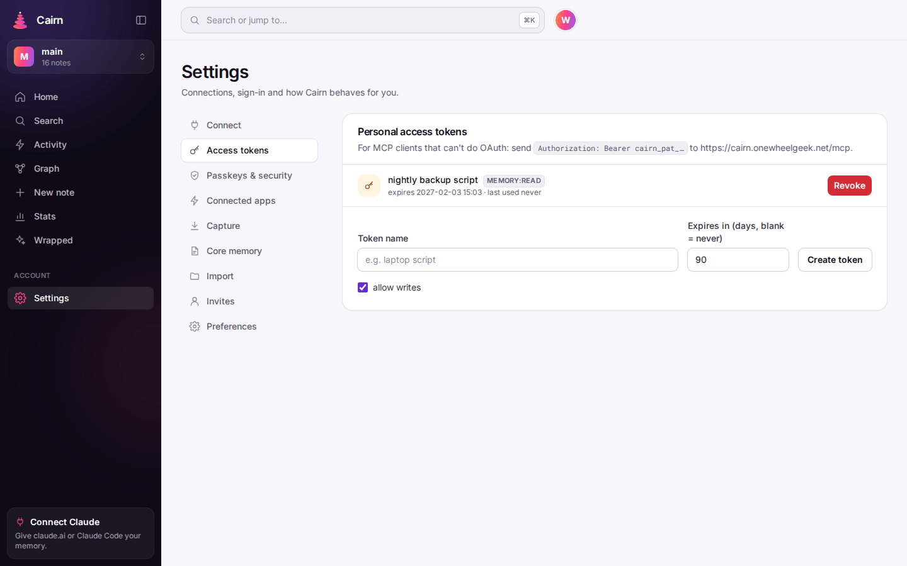

**Home** and the landing page.
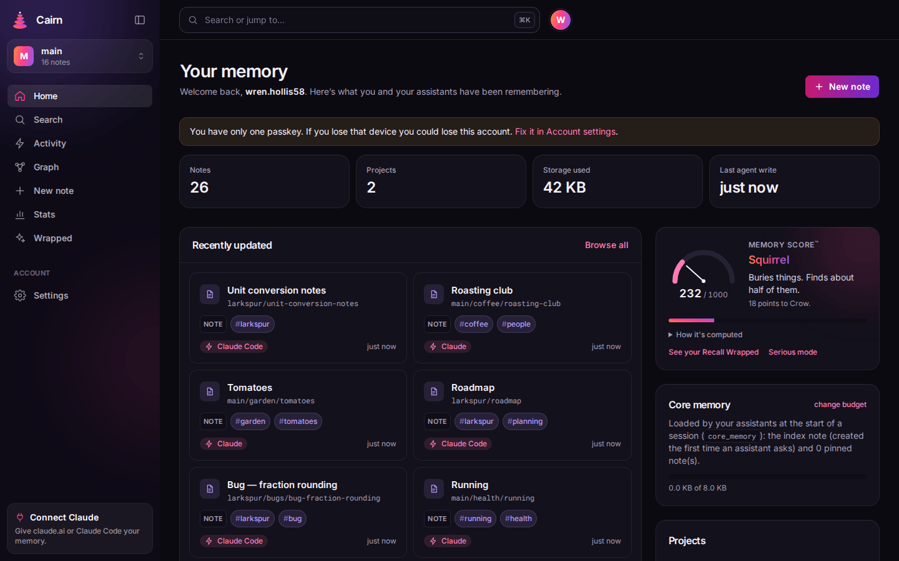
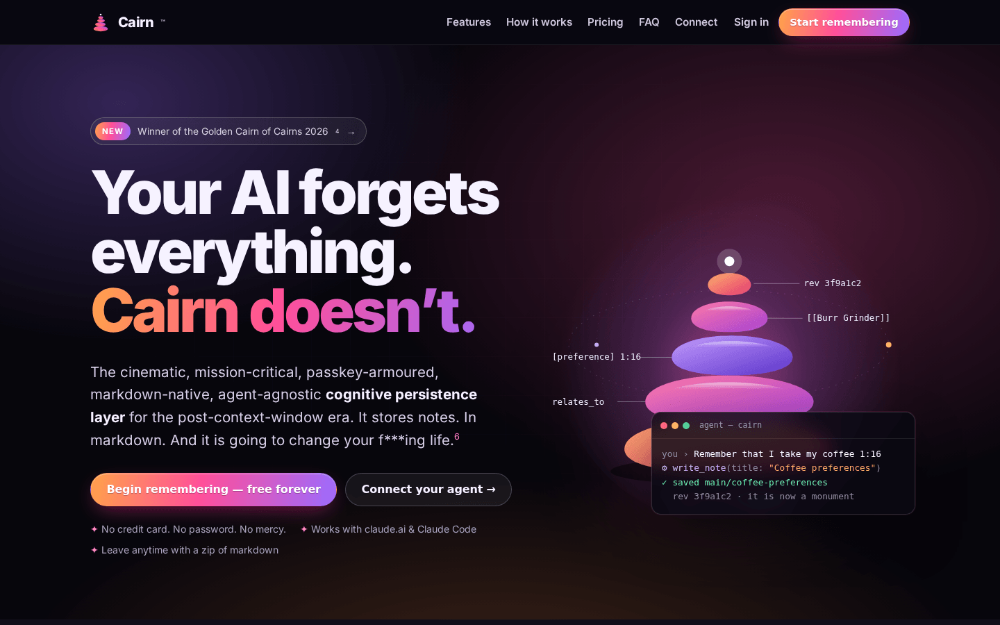

**On a phone.**

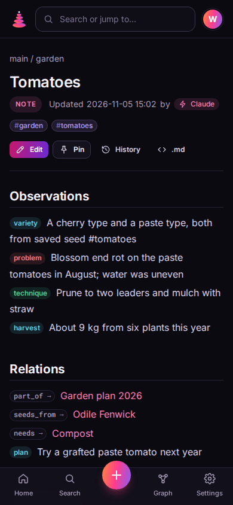 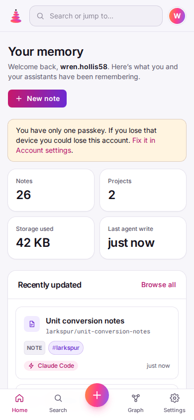

## Deploy your own

[](https://deploy.workers.cloudflare.com/?url=https://github.com/jclement/cairn)

No terminal needed. You need a Cloudflare account and a GitHub account.
[Workers Paid](https://developers.cloudflare.com/workers/platform/pricing/) ($5/month) is
recommended. Everything Cairn uses exists on the Free plan, but Free allows 10 ms of CPU per
request. Cairn hasn't been measured against that limit, and search, imports and exports can
exceed it.

1. **Click the button.** Cloudflare copies this repository into a new repository in your GitHub
   account and lists what it will create: a D1 database, a KV namespace, an R2 bucket, a
   Vectorize index, a Durable Object, rate limiters and Workers AI. The defaults are fine. Leave
   `PUBLIC_URL` empty; sign-up is invite-only and email capture is off.
2. **Deploy.** Cloudflare builds and deploys it (the build applies the database migrations).
   Cairn is then live at `https://cairn.<your-subdomain>.workers.dev`.
3. **Optional: add your own domain.** In the dashboard open **Workers & Pages → cairn →
   Settings → Domains & Routes → Add → Custom domain** (its DNS zone must be on the same
   account). Do it **before** step 4 and claim at that domain, because passkeys are bound to the
   address you claim at.
4. **Claim it.** Open the site. It shows **Claim this Cairn** and writes a one-time claim code
   to the Worker's log: open **Workers & Pages → cairn → Logs** (live logs, or
   `npx wrangler tail`) and find `Cairn claim code: XXXXX-XXXXX`. Enter it with a username and
   create your passkey. You are the admin, the claim page is gone for good, and the address you
   claimed at becomes Cairn's URL. Each code works for 30 minutes; **Write a new code to the
   logs** makes another. Until someone claims the site it shows nothing else, so claim it right
   after deploying.

Then save the 10 recovery codes it shows, add a second passkey (Settings → Account), invite
people from Settings → Invites, and [connect Claude](#connect-claude-and-other-assistants).

**Updating.** Settings → Admin shows the running version and says when a newer Cairn is out. In
your repository on GitHub open **Actions → Update Cairn → Run workflow**: it merges the latest
`jclement/cairn` and pushes, and Cloudflare redeploys (if you forked instead, use **Sync fork**).
See [Upgrading](#upgrading).

**Moving to another address later.** Settings → Admin → This Cairn → *Move to another
address*. Every existing passkey stops working; people sign in at the new address with a
recovery code and add a new passkey. Setting `PUBLIC_URL` in your repository's
`wrangler.jsonc` pins the URL instead (it always wins).

### From the command line instead

Needs **Node 24** (or [mise](https://mise.jdx.dev), which installs it from `mise.toml`) and git.

```sh
git clone https://github.com/jclement/cairn.git      # or your fork
cd cairn
npm ci
npx wrangler login
npm run setup:cloudflare                                       # your workers.dev URL
npm run setup:cloudflare -- --url https://cairn.example.com    # or pin a custom domain
```

`scripts/setup-cloudflare.mjs` is safe to run again. It:

1. checks the login;
2. creates whatever doesn't exist yet: the D1 database `cairn`, the KV namespace `cairn-oauth`,
   the Vectorize index `cairn-notes` (1024 dimensions, cosine) and the R2 bucket `cairn-files`;
3. writes their ids, the sign-up policy (and with `--url` the route and `PUBLIC_URL`) into the
   top level of your `wrangler.jsonc`;
4. builds, applies the D1 migrations and deploys (`npm run deploy`).

Then claim the site as in step 4 above: run `npx wrangler tail` in another terminal and open
the URL it prints.

Options: `--open-signup` (anyone can sign up; default invite-only), `--email cairn@example.com`
([email capture](#email-capture-optional)), `--setup-token` (also set a `CAIRN_SETUP_TOKEN`
secret and print it once; whoever enters it at sign-up becomes an admin, and the claim page is
off), `--dry-run` (show what exists and what would change).

**About `wrangler.jsonc`.** Its top level is the template the button and `setup:cloudflare`
deploy, with no account ids in it. `env.owg` is the maintainer's own instance (deployed with
`--env owg` only from `jclement/cairn`), and `env.local` is for local development; leave both
alone. By hand instead of the script: create the four resources above, add `"database_id"` and
the KV `"id"` to the top-level bindings (wrangler also finds the database by its name), and run
`npm run deploy`. It runs `wrangler d1 migrations apply DB --remote`, then `wrangler deploy`.

Check a deployment:

```sh
curl https://cairn.example.com/health            # {"ok":true,"version":"…"}
curl -i -X POST https://cairn.example.com/mcp    # 401 with a WWW-Authenticate header (503 until claimed)
```

### Email capture (optional)

1. Set `vars.INBOUND_EMAIL_ADDRESS` (for example `cairn@example.com`) and deploy.
2. In the Cloudflare dashboard, open your domain and go to **Email → Email Routing**.
3. Enable Email Routing. It adds MX and TXT records.
4. Under **Routing rules**, create the custom address and set the action to **Send to a Worker**
   → `cairn`.
5. Optionally, turn on **subaddressing** in its settings, so `cairn+KEY@example.com` works.

Each person creates a private inbox key in Settings → Capture. Mail sent to `cairn+KEY@…`, with
`[k:KEY]` in the subject, or from a trusted sender that passes DMARC/DKIM becomes a note in
`inbox/`, with its attachments.

### AI features and Jev (optional)

Cairn calls Workers AI for four things:

- embeddings
- Jev (`typesafe/jev`): write hints and search re-ranking
- image captions
- the weekly digest

Jev is a third-party model served through Workers AI and billed to your account like the
others. Each call is time-boxed and charged to a per-user daily token budget
(`AI_DAILY_TOKENS`, default 1,000,000). When a user's budget runs out, the AI extras stop for the
rest of the day. Search and writes keep working.

To turn features off, set the model variable to `""`: `JEV_MODEL` for hints and re-ranking,
`VISION_MODEL` for captions. Usage per user and per model is shown at `/app/stats`. Without the
`AI` and `VECTORIZE` bindings Cairn still works, with keyword-only search and no extras.

### All settings

| `vars` key | In `wrangler.jsonc` | Meaning |
|---|---|---|
| `PUBLIC_URL` | `""` | Empty: the address the site is claimed at (Settings → Admin can move it). Set: pins the URL; passkeys and OAuth are bound to it |
| `APP_NAME` | `Cairn` | Shown in the app and on the consent page |
| `OPEN_SIGNUP` | `"false"` | `"true"` lets anyone sign up; otherwise sign-up needs an invite |
| `INVITES_PER_USER` | `5` | Open invite links a non-admin may hold |
| `IMPORT_ENABLED` | `"true"` | The .zip import in Settings → Import (off unless `"true"`) |
| `SCHEMA_ENABLED` | `"true"` | The `check_schema` tool (off unless `"true"`) |
| `BM_COMPAT` | `"false"` | Also register Basic Memory's `bm_*` tool names |
| `EMBEDDING_MODEL` | `@cf/qwen/qwen3-embedding-0.6b` | Must match the index's 1024 dimensions; changing it means re-embedding |
| `JEV_MODEL` | `typesafe/jev` | `""` turns hints and re-ranking off |
| `VISION_MODEL` | (unset: `@cf/meta/llama-4-scout-17b-16e-instruct`) | Image captions; `""` turns them off |
| `DIGEST_MODEL` | `@cf/google/gemma-4-26b-a4b-it` | The weekly digest |
| `AI_DAILY_TOKENS` | `1000000` | Per-user daily AI budget |
| `INBOUND_EMAIL_ADDRESS` | (unset) | Email capture address; unset or `""` turns capture off |

There are no required secrets. The optional `CAIRN_SETUP_TOKEN` turns the claim page off:
whoever enters it at sign-up or in Settings → Admin becomes an admin. `package.json` → `cloudflare.bindings` describes every
binding. [docs/SELF-HOSTING.md](docs/SELF-HOSTING.md) has the long version of each step.

## Connect Claude and other assistants

Your MCP URL is `PUBLIC_URL` + `/mcp`, and Settings in the app shows it. The first connection
sends you to Cairn, where you sign in with your passkey and allow **read** or **read and write**.

- **claude.ai and Claude Desktop:** Settings → Connectors → **Add custom connector**, then paste
  the URL.
- **Claude Code:**

  ```sh
  claude mcp add --transport http cairn https://cairn.example.com/mcp
  ```

  Then run `/mcp` in Claude Code, pick `cairn` and choose **Authenticate**. Alternatively, the
  repository is a plugin marketplace that adds the connection, the skills and a session-start
  reminder:

  ```sh
  export CAIRN_URL=https://cairn.example.com        # before starting Claude Code
  # in Claude Code:
  /plugin marketplace add jclement/cairn
  /plugin install cairn@cairn
  ```

  Use one way or the other, not both.
- **Codex CLI:** run `codex mcp add cairn --url https://cairn.example.com/mcp`, then
  `codex mcp login cairn`.
- **Anything else:** add a streamable-HTTP MCP server at the URL. A client without OAuth can use
  a personal access token from Settings: send `Authorization: Bearer cairn_pat_…`.

**Then paste one line into the assistant:**

```
Set up Cairn for me: read https://cairn.example.com/setup.md and follow it.
```

`/setup.md` is generated by your instance. It has the assistant check the connection and ask how
you'll use Cairn. Then it installs the matching skills from `/skills/` in the way that suits your
client, or gives you the download links on claude.ai. Settings → Connected apps lists every grant
with a revoke button.

## Files

Attach PDFs, images and text files to notes: drop or paste them into the editor, mail them to your
inbox address, or have an assistant use `attach_file` (base64 up to 2 MB, or a one-time upload URL
for files up to 10 MB). Cairn reads each file's text: a PDF's text page by page (through Workers
AI's toMarkdown; up to 200 pages and 500 KB of text), what an image shows and every word in it
(the vision model), a text file as is. Secrets are redacted. Search then finds a note through the
files it links, below matches in the note itself, with the page: `from invoice.pdf, pages 1–4 …
p. 3: Total due $1,240`. Scanned PDFs without a text layer are marked "no text" (a Worker can't
render pages for OCR).

Ask an assistant for the original and it gives you a download link that needs no sign-in, valid
for an hour (`read_note file=<id>`); deleting the file kills the link. Each file's text state
(read, pending, failed, no text) shows on the Files page and under the note, with the text itself
behind a toggle and a "Read again" button. Files stored before this feature: the Files page offers
"Read their text" to the project's owner, and a queue works through them every 15 minutes. Reading
uses the owner's daily AI budget (`AI_DAILY_TOKENS`); when it runs out, files wait until the next
day. The text counts toward storage with the file.

## Sharing a project

Share a project (say, a team's `barreleye`) with colleagues on the same Cairn:

1. Open the project and choose **Share**. Create a link: **editor** (read and write) or
   **reader** (read only), valid 1–30 days (7 by default), optionally single use. Copy it: only a
   hash is stored, so it is shown once.
2. Send it. Whoever opens it signs in, or creates an account with a passkey (the link works as an
   invite even when sign-up is invite-only, for up to 10 accounts per link), and confirms joining.
   A link never changes an existing member's role without them confirming it, and never lowers it.
3. The same page lists members (change a role, remove someone; it takes effect on their next
   request) and links (with use counts; revoke any). Members can leave.

Members see the project as `owner/name` (`jeff/barreleye`) in the app and for their assistants
(`project="jeff/barreleye"`), so it never collides with a project of their own; the owner keeps
calling it `barreleye` (or `jeff/barreleye`). Every change records who made it and with which
app, shown in the note history and the activity feed.

What stays personal: core memory loads your own default project, the email inbox, recovery codes
and passkeys are yours, and AI use (search re-ranking, query embeddings, write hints) counts
against the person acting. Storage counts against the project's owner. "Download everything" holds
the projects you own; owners and editors can download a shared project. Import into a shared
project, the nightly gardening checklist and the weekly digest are the owner's. Deleting an
account removes its memberships; deleting an owner deletes their projects, and members lose them.

**Guidance for assistants.** Each project can have a short guide (what belongs there, its
folders, tags and naming; owner and editors edit it on the Share page, members read it), and each
person has private guidance in Settings → Account ("work and customers → jeff/barreleye; family →
main"). Assistants see both in `projects` (`command=list`; `command=guide` reads a whole guide)
and `help`, the guide at the top of `build_context` and `recent_activity`, and one line pointing
at it with every write. New projects can start from a personal or team guide.

## Deploy from GitHub Actions

`.github/workflows/deploy.yml` runs on every push to `main`:

1. A `check` job runs `mise run check` (typecheck, lint, tests, probes).
2. If that is green, a `deploy` job runs in the `production` environment. It runs
   `mise run deploy` (migrations, then `wrangler deploy --env owg`) and smoke-tests `/health`,
   the OAuth metadata and `/mcp` at `env.owg`'s `PUBLIC_URL` in `wrangler.jsonc`.

Both jobs run only on `jclement/cairn`. A copy made by the Deploy button needs none of this:
Cloudflare Workers Builds redeploys it on every push. To deploy a fork from Actions instead:

1. Add your own environment to `wrangler.jsonc` (copy `env.owg`, with your ids, route,
   `PUBLIC_URL` and a `name`), point the workflow's `if:` at your repository and `mise run
   deploy` / the smoke test at your environment, and commit (there are no secrets in it).
2. In GitHub, go to **Settings → Environments** and create `production`. Add a **secret**
   `CLOUDFLARE_API_TOKEN` and a **variable** `CLOUDFLARE_ACCOUNT_ID`. The account id is shown in
   the dashboard's account home and in `npx wrangler whoami`.
3. Create the token at **My Profile → API Tokens → Create Token → Custom token**, with only these
   permissions:

   | Scope | Permission | Why |
   |---|---|---|
   | Account | Workers Scripts: Edit | upload the Worker, its assets, Durable Object and cron |
   | Account | D1: Edit | `d1 migrations apply --remote` |
   | Account | Workers KV Storage: Edit | the `OAUTH_KV` binding |
   | Account | Workers R2 Storage: Edit | the `FILES` binding |
   | Account | Vectorize: Edit | the `VECTORIZE` binding |
   | Account | Account Settings: Read | wrangler's account lookup |
   | Zone (your zone only) | Workers Routes: Edit | the custom-domain route; omit for workers.dev |
   | User | User Details: Read, Memberships: Read | wrangler's identity check |

   Scope it to your account (and your zone only). If a deploy fails with an authorization
   error naming a resource, add that resource's permission. `mise run prod:status` (the health
   report under [Troubleshooting](#troubleshooting)) reuses this token: it queries D1, reads the
   Vectorize index and lists deployments, all covered above.

Secrets set with `wrangler secret put` (such as the optional `CAIRN_SETUP_TOKEN`) survive
deploys, and CI never needs them.

## Costs and limits

From the estimates in [docs/research/cloudflare.md §6](docs/research/cloudflare.md):

| | Heavy personal user | 10-person family or team |
|---|---|---|
| Workers, Durable Objects, D1, KV | within Paid's included amounts | ~$0.15 |
| Vectorize | ~$0.45 | ~$3.70 |
| Workers AI (embeddings, Jev, captions, digest) | ~$0–2 | ~$2–8 |
| R2 (attachments) | pennies | pennies |
| **Total** | **≈ $5/month** (the Paid minimum) | **≈ $5–15/month** |

These are estimates, not measurements. `AI_DAILY_TOKENS` caps what any one person can spend on
AI.

Built-in limits per person:

- 1 MB per note
- 50 MB in all (notes, history and attachments)
- 20 projects
- 10 MB per file and 5,000 files
- 60 writes and 60 searches a minute
- imports of up to 20 MB and 5,000 files per zip

Sign-in and OAuth are rate-limited per IP, and invite changes per person.

## Security

The full threat model and how to report a vulnerability are in [docs/SECURITY.md](docs/SECURITY.md).

- **Passkeys only**, bound to `PUBLIC_URL`. Recovery codes are hashed and single-use, and are
  good only for adding a passkey.
- **Sessions** are opaque, hashed, `__Host-` cookies (HttpOnly, Secure, SameSite=Lax). Every
  POST must carry `PUBLIC_URL`'s Origin. Exports, account deletion and changes to credentials
  need a fresh passkey check.
- **Isolation:** each project is its own Durable Object with its own SQLite database. It is
  reached only after D1 confirms you own it. Admins cannot read notes.
- **OAuth:** 1-hour access tokens and rotating refresh tokens. Read or write scope is chosen at
  consent, and grants can be revoked. Tokens and PATs are stored only as hashes.
- **Untrusted content:** notes render without raw HTML under a strict CSP. Tools return note
  text as data. Attachments are served by sniffed type, and non-images download. Server-side
  fetches refuse private addresses.
- **Your data stays in your account:** nothing leaves Cloudflare. The AI calls go to Workers AI
  on your own account.

## Backups and export

- **Export:** Settings → **Download everything** gives a zip of every project. Notes are
  byte-for-byte as stored, attachments are included, and there is an index. It drops into Basic
  Memory or Obsidian. Each note also has a raw `.md` download.
- **D1** (accounts and the directory): `npx wrangler d1 time-travel restore cairn --timestamp=…`
  restores to any point in the last 30 days (Paid) or 7 days (Free).
- **Notes** live in Durable Object SQLite, which Cloudflare keeps with point-in-time recovery.
  There is no Cairn command for that restore yet, so the export is your portable backup.

## Upgrading

Settings → Admin → This Cairn says when a newer release or newer commits on `jclement/cairn`
exist (checked once a day; quiet if GitHub can't be reached).

- **Deployed with the button:** GitHub → your repository → **Actions → Update Cairn → Run
  workflow**. It merges `jclement/cairn` `main` into yours and pushes; Workers Builds redeploys,
  applying new D1 migrations first. If it reports a merge conflict (usually `wrangler.jsonc`),
  merge by hand: `git pull https://github.com/jclement/cairn.git main && git push`.
- **A fork:** **Sync fork** on GitHub, or merge upstream yourself.
- **From the command line:**

  ```sh
  git pull https://github.com/jclement/cairn.git main
  npm ci
  npm run deploy           # applies new D1 migrations (migrations/), then deploys
  ```

The Durable Objects upgrade their own SQLite schema on first use. Read the commit log before
jumping many versions.

## Troubleshooting

`mise run prod:status` (with `CLOUDFLARE_API_TOKEN` and `CLOUDFLARE_ACCOUNT_ID` set) reports:

- the deployed version
- migrations applied vs pending
- AI failure rates
- the last nightly run
- stuck imports
- email ingestion
- the Vectorize index

It exits non-zero on a red flag. Admins see the same at `/app/admin/health`.

| Symptom | Cause |
|---|---|
| Every form says *Cross-origin request refused* | The browser's URL doesn't match `PUBLIC_URL` exactly (scheme, host, port). This is common when the site is opened at workers.dev while `PUBLIC_URL` is the custom domain, or the other way round. |
| Passkey prompt fails or finds no passkey | Passkeys belong to `PUBLIC_URL`'s hostname. A passkey made on workers.dev doesn't work on your custom domain, or the other way round. If `PUBLIC_URL` changed after sign-up, use a recovery code and add a new passkey. |
| claude.ai can't connect | `/.well-known/oauth-protected-resource` and `/.well-known/oauth-authorization-server` must return JSON naming your `PUBLIC_URL`. A custom domain must be the route, not just DNS. |
| `Exceeded CPU` in the logs | You're on the Free plan; move to Workers Paid. |
| Search ignores meaning | No `AI`/`VECTORIZE` binding, or the index isn't 1024-dimensional. |
| *daily AI budget reached* | That person spent `AI_DAILY_TOKENS`. The budget resets at midnight UTC. |
| Uploads say attachments aren't configured | The `FILES` R2 bucket is missing. |
| Email never arrives | Check, in order: the Email Routing rule, `INBOUND_EMAIL_ADDRESS`, subaddressing for `+KEY`, and the sender's DMARC/DKIM. Worker logs show rejections. |
| `wrangler deploy` says *You must use a real database* | `database_id` is still the maintainer's. Put yours in (step 3). |

## Development

```sh
mise run setup                   # npm ci
cp .dev.vars.example .dev.vars   # optional: a local setup token, offline semantic search
mise run dev                     # http://localhost:8787 (local D1 migrations + bundles first)
mise run test                    # vitest inside workerd, offline
mise run check                   # lint + tests + parser probes: the gate for every change
```

Other tasks:

- `mise run lint` (typecheck, biome, plugin-skill drift; read-only)
- `mise run fmt`
- `mise run build:client`
- `mise run migrate:local`
- `mise run plugin:sync` (copies `skills/` into the plugin and the Worker)

`mise tasks` lists them all.

The `local` environment in `wrangler.jsonc` has no Workers AI or Vectorize, because both need a
Cloudflare login even under `wrangler dev`. Search there is keyword-only unless you set
`CAIRN_FAKE_EMBEDDINGS=1`. Locally only, `GET /app/dev-login?u=<name>` signs you in without a
passkey, for headless UI checks.

**Live checks against your instance.** Both scripts create a throwaway account and delete it
afterwards, and both need Playwright with Chromium:

```sh
npm install --no-save playwright && npx playwright install chromium    # once
CAIRN_URL=https://cairn.example.com mise run smoke:live    # sign-up, app pages, PAT, MCP, export, deletion
CAIRN_URL=https://cairn.example.com mise run oauth:live    # Claude Code, claude.ai and DCR OAuth flows
```

With an existing install, point the scripts at it with `PLAYWRIGHT=/path/to/playwright/index.mjs`
and `CHROMIUM_PATH=/path/to/chrome`. Your instance must allow sign-up (`OPEN_SIGNUP="true"`) for
the throwaway account.

### Layout

```
src/index.ts      Worker entry: OAuth provider, /mcp, email() and scheduled() handlers
src/vault/        VaultDO, one SQLite Durable Object per project: notes, FTS5, revisions, search
src/mcp/          the MCP tools, receipts, instructions, the core_memory prompt
src/memory/       supersession, history, nightly gardening and digest
src/capture/      attachments (R2), email, clipper, SSRF-guarded fetch
src/jev/          Jev hints and re-ranking
src/web/          the Hono app: viewer, editor, settings, consent, export, import
src/client/       browser code, bundled into public/app/dist/
migrations/       D1 migrations
skills/, plugin/  agent skills and the Claude Code plugin
docs/             DESIGN.md, SELF-HOSTING.md, SECURITY.md, research/
```

## Licence

[MIT](LICENSE) © 2026 Jeff Clement. Cairn's note format and tool behaviour follow Basic Memory's
published documentation; it contains no Basic Memory (AGPL) code. owg-css is MIT.
