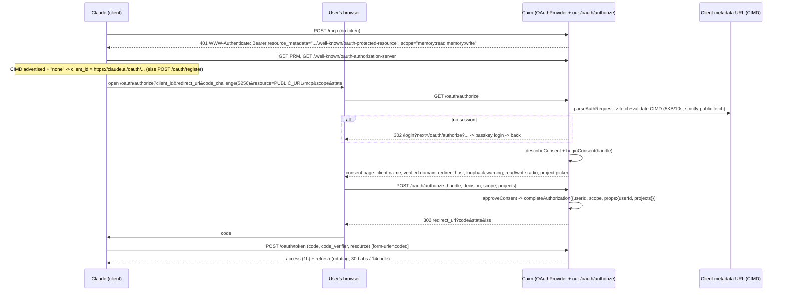

# Cairn research: authentication, users and OAuth for MCP

Research worker: `auth` · 2026-11-04 · for `cairn-lead`

**Summary.** Build everything in one Worker:

- **Login:** passkeys through `@simplewebauthn/server` 14.x.
- **Sessions:** opaque, hashed and stored in D1.
- **OAuth:** `@cloudflare/workers-oauth-provider` 1.2.x in one-Worker `OAuthProvider` mode, with CIMD *and* DCR turned on.
- **Consent page:** our own, built on the library's new consent helpers (`describeConsent` / `beginConsent` / `approveConsent`).
- **Personal access tokens:** Cairn-issued and accepted through `resolveExternalToken`.
- **Recovery:** recovery codes, an admin-issued reset link, and a secret-based break-glass for the operator. No email.
- **Projects:** single-owner in v1. The data model is project-scoped so sharing can be added later without a migration.

Things I checked directly (package tarballs, primary docs) are cited. Anything I inferred is marked *(inferred)*.

---

## 1. Passkeys on Workers

### Library choice

**`@simplewebauthn/server` 14.0.3** is current (npm, modified 2026-09-25).

I downloaded the tarball and checked it:
- All cryptography goes through `globalThis.crypto`. `helpers/iso/isoCrypto/getWebCrypto.js` throws `MissingWebCrypto` if that global is absent.
- It has no `node:crypto`, `buffer` or `fs` imports.
- Its dependencies are pure JS: `@peculiar/asn1-*`, `@peculiar/x509`, `@levischuck/tiny-cbor`, `@hexagon/base64` and `reflect-metadata`.

So it should run on workerd. JSR lists Cloudflare Workers as a supported runtime for 13.3.x ([jsr.io/@simplewebauthn/server@13.3.2](https://jsr.io/@simplewebauthn/server@13.3.2)). The v14 docs list only Node 22+ and Deno 2.4+ ([simplewebauthn.dev](https://simplewebauthn.dev/docs/packages/server)), so **Workers support for v14 is likely but not documented** *(inferred)*.

Two v14 changes matter:
- **ML-DSA.** v14 adds ML-DSA (post-quantum) passkeys, and `generateRegistrationOptions()` *prefers ML-DSA-44 where the runtime supports it* ([CHANGELOG](https://github.com/MasterKale/SimpleWebAuthn/blob/master/CHANGELOG.md)). workerd's WebCrypto almost certainly has no ML-DSA *(inferred)*. Pass `supportedAlgorithmIDs: [-8, -7, -257]` (Ed25519, ES256, RS256) explicitly on both generation and verification so the algorithm list is deterministic.
- **Bundle size.** `@peculiar/x509` is only needed for attestation verification, but it is imported anyway. It adds bundle weight, though well within Workers limits *(inferred)*.

**First implementation step:** a 30-minute spike that runs registration and authentication under `vitest-pool-workers` or `wrangler dev`, to turn "likely" into "verified".

Alternatives:
- **`@passwordless-id/webauthn` 2.4.1** says it supports Cloudflare Workers explicitly. It has a smaller API and a smaller community. Keep it as the fallback if the spike fails.
- **`@oslojs/webauthn` 1.0.0** is low-level parsing only: you write the ceremony logic yourself. Its author has reportedly said to avoid the oslo packages in favour of plain WebCrypto (as cited in an emdash PR found through search; secondary source). **Leave it out.**
- **Hand-rolled** (CBOR + COSE → WebCrypto `verify`) is roughly 400 lines and very easy to get subtly wrong (counter, flags, origin and RP ID hash checks). Not worth it.

Browser side: `@simplewebauthn/browser` (`startRegistration`, `startAuthentication` with `useBrowserAutofill`).

### Ceremony parameters (recommended)

| Setting | Value | Why |
|---|---|---|
| `attestationType` | `'none'` (the default) | No enterprise device policy, and attestation is a privacy cost. Since v13, `'indirect'` is gone ([CHANGELOG](https://github.com/MasterKale/SimpleWebAuthn/blob/master/CHANGELOG.md)). |
| `residentKey` | `'required'` | Usernameless login and conditional UI need discoverable credentials. |
| `userVerification` | `'required'` | The passkey is the *only* factor, so require a PIN or biometric. |
| `userID` | 32 random bytes per user, stored on the user row | Never the database ID or the handle (WebAuthn privacy guidance). |
| `userName` / `userDisplayName` | the user's handle / display name | Shown in OS passkey pickers. |
| `excludeCredentials` | the user's existing credentials | Stops the same authenticator registering twice. |
| `allowCredentials` (login) | empty | Discoverable flow: the authenticator picks the account. |
| Challenge storage | D1 row `{id, challenge, user_id?, purpose, expires_at}`, referenced by a short-lived `__Host-cairn_chal` cookie. Delete on use. | Single-use, and strongly consistent. **Not KV**: KV is eventually consistent (about 60 s) and its minimum TTL is 60 s, so a replayed challenge could be accepted. |

**Store per credential** (from the SimpleWebAuthn docs): `id` (base64url, unique index), `public_key` (blob), `user_id`, `counter`, `device_type` (`singleDevice` / `multiDevice`), `backed_up`, `transports`. Add `name` (user-editable, e.g. "MacBook Touch ID"), `created_at`, `last_used_at` and `aaguid`. The AAGUID lets the UI show "iCloud Keychain" or "1Password" from the community AAGUID list *(inferred, nice-to-have)*.

**Counter:** treat a non-increasing, non-zero counter as a warning (log it and flag the credential). Do not hard-fail: synced passkeys report 0.

**Multiple passkeys per user:** yes, unlimited. The account page lists them with rename and remove, and refuses to remove the last one unless the user has unused recovery codes.

### Conditional UI (autofill)

The login page has one `<input autocomplete="username webauthn">` field. On page load it calls `startAuthentication({ optionsJSON, useBrowserAutofill: true })`, and it also shows a "Sign in with a passkey" button that runs the modal flow. The username field exists only to trigger autofill. Login never needs it, because the credential identifies the user.

**Where supported** (WebAuthn L3 Signal API, mostly Chromium today *(inferred)*), call the signal methods so authenticators stay in sync:
- `signalUnknownCredential` when an assertion arrives for a deleted credential.
- `signalAllAcceptedCredentials` after a user removes a passkey.
- `signalCurrentUserDetails` after a rename.

SimpleWebAuthn 14 wraps these as `sendSignal()`. Best-effort only.

### RP ID and origin for self-hosters

- **RP ID = the exact hostname Cairn is served on**, taken from one configured variable (`PUBLIC_URL`) and *never* from the request's `Host` header.
- **Expected origin = `PUBLIC_URL`'s origin.** `expectedOrigin` and `expectedRPID` both accept arrays, which allows a temporary second origin during a migration.
- **`workers.dev` is on the Public Suffix List.** I checked the current PSL: `workers.dev` and `pages.dev` are both listed. So the RP ID must be the full `cairn.<account>.workers.dev`. A passkey made there can never be used on another `*.workers.dev` name. That is fine, and it isolates tenants on shared hosting.
- **Changing domains orphans passkeys.** A passkey is bound to its RP ID, so a self-hoster who starts on `workers.dev` and later moves to `memory.example.com` loses every passkey. Two mitigations:
  1. **Pick the final domain before the first passkey.** The setup page should say this plainly.
  2. **Migration path:** keep the old RP ID and serve `/.well-known/webauthn` on the *old* host, listing the new origin (WebAuthn **Related Origin Requests**: the browser fetches `https://{rpId}/.well-known/webauthn`; see the [explainer](https://github.com/w3c/webauthn/wiki/Explainer:-Related-origin-requests/24bf9cc402bf9f21a57b9f87af3dc4a38b93f8f5)). Support is Chrome/Edge 128+ and Safari 18+, and Firefox per one secondary source *(unverified)*. Simpler fallback: everyone re-enrolls with a recovery code or an admin reset link.

  Recommend documenting the migration path and building only the fallback in v1.
- **Allowing a parent domain as RP ID** (e.g. `example.com` for `cairn.example.com`) would let one passkey cover sibling apps. Expose it as an optional `RP_ID` variable, defaulting to the exact host.
- **If both the `workers.dev` route and a custom domain are live**, the `workers.dev` route should 301 to `PUBLIC_URL`. Otherwise passkeys, the OAuth issuer and cookies all split across two hosts.

---

## 2. Sessions

| Decision | Recommendation |
|---|---|
| Token | **Opaque.** 32 random bytes, base64url. Store only `SHA-256(token)` in D1. Signed or stateless cookies (JWT and the like) cannot be revoked, and "log out everywhere" is a requirement. |
| Cookie | `__Host-cairn_session=<token>; Secure; HttpOnly; SameSite=Lax; Path=/`. The `__Host-` prefix forbids a `Domain` attribute, so other subdomains can't set or overwrite it. `Lax` (not `Strict`), so a user following a link from Claude to the OAuth authorize page arrives signed in. |
| Storage | **D1.** A session lookup is one indexed read by primary key. Writes (create, revoke, touch) must be visible at once, which rules out KV (eventual consistency, about 60 s). A Durable Object per user would also work but adds a binding and a hop for no gain. Throttle `last_seen_at` updates to one write every 10 minutes or so. If D1 read replication is on, revocation checks must read with the Sessions API in `first-primary` mode, or revocation can lag *(inferred)*. |
| Lifetime | 30-day **idle** timeout (sliding), 90-day **absolute** cap. |
| Fresh authentication | Recent-auth (a passkey ceremony within the last 10 minutes, `auth_at` on the session) is required for: adding or removing a passkey, regenerating recovery codes, creating a personal access token, admin actions, and deleting the account. |
| CSRF | (1) `SameSite=Lax` blocks cross-site POSTs carrying the cookie. (2) Every non-GET request must have an `Origin` header equal to `PUBLIC_URL`'s origin (reject a missing `Origin` on state-changing browser routes). (3) The JSON API requires `Content-Type: application/json`, which a cross-site form cannot send without a preflight. No synchronizer tokens are needed, except that the OAuth consent form uses the library's browser-bound one-time `handle`. |
| Logout | `POST /auth/logout` deletes this session. `POST /auth/logout-all` deletes every session for the user. `logout-all` does **not** revoke OAuth grants or PATs: they are separate credentials, each with its own revoke button. One "Sign out everything" button should do all three. |
| Session table | `sessions(id_hash PK, user_id, created_at, last_seen_at, auth_at, expires_at, user_agent, ip_country)`. The account page lists sessions with a "revoke" button each. |

---

## 3. Multi-user model

### Who can sign up

1. **Bootstrap.** "First user is admin" alone is a race. A freshly deployed public URL can be claimed by anyone who finds it first, and `workers.dev` names are guessable.
   - Require a **setup token**. `/setup` accepts it only while the users table is empty.
   - The token comes from the secret `CAIRN_SETUP_TOKEN` (`wrangler secret put`). If that secret is unset, the setup page shows instructions and refuses to proceed.
   - Optional bonus: the Worker generates a random token on first request and logs it once, so `wrangler tail` shows it. That keeps the flow to one command.

   Both approaches preserve "close to one `wrangler deploy`".
2. **Invites (the default after bootstrap).** An admin creates an invite link: a single-use or N-use token with an expiry (default 7 days, single use) and an optional role. `/signup?invite=…` registers a passkey and creates the user. Store the hashed token and record who invited whom.
3. **Open registration.** An admin toggle, **off by default**, with an optional allowlist of email domains or handles. Even when open, signup is rate-limited (Workers Rate Limiting binding, keyed by IP).

### Roles

Keep it to two:
- **`admin`:** manage users, invites, instance settings, the OAuth client policy, and reset links.
- **`member`.**

The last admin cannot be demoted or deleted. Instance-level roles have no bearing on data access, which is purely ownership-based in v1. Admins **cannot read other users' notes** through the UI or API. That avoids an admin backdoor and makes "hard isolation" a true statement. The operator with Cloudflare access can of course read D1 directly. Document that honestly.

### Sharing

**Recommendation: no shared projects in v1, but design for them.**
- Every data row carries `project_id`, and every project has `owner_user_id`.
- Create a `project_members(project_id, user_id, role: 'owner'|'editor'|'viewer')` table now, holding only the owner row in v1.
- All data access goes through one choke point, `requireProjectAccess(principal, projectId, 'read'|'write')`, which consults `project_members`.
- Shared projects (v1.1) then become a UI feature plus invite-to-project, with no data migration.

Why defer:
- Sharing complicates prompt-injection containment: an agent with write access to a shared project can poison a teammate's memory.
- It complicates export and deletion semantics.
- Single-user correctness should come first.

The brief's "team memory" is served in v1 by several users on one instance. Collaboration comes in v1.1.

### Hard isolation

- **Principal resolution happens once, at the edge of the request.** Session → `user_id`; OAuth props → `{userId, scopes, projects}`; PAT → the same shape. Handlers receive a `Principal`, never a raw user ID from input.
- **Every query is scoped by `project_id`, and that `project_id` passed `requireProjectAccess`.** No query takes `user_id` from request parameters.
- **Search indexes** (D1 FTS, Vectorize) must filter by `project_id` *in the index query*, not after it. For Vectorize, use metadata filtering or a per-user namespace *(depends on the cf.md findings)*.
- **Tests:** a cross-tenant test suite, with user A trying B's note IDs, project IDs and search, for every MCP tool and REST route.
- **Alternative to evaluate in cf.md:** one Durable Object (SQLite) per user, giving physical isolation. It is stronger, but sharing and cross-user admin queries get harder. I lean towards D1 with the choke point *(opinion)*.

---

## 4. Recovery when a passkey is lost

We may have no email sender, so recovery cannot depend on one. In priority order:

1. **Prevent the problem.** After signup, nudge the user to add a second passkey: "Add a passkey on another device." Synced passkeys (iCloud Keychain, Google Password Manager, 1Password) already survive device loss, which covers most users. Show each passkey's `backed_up` flag. If the user's only passkey is not backed up, show a persistent warning.
2. **Cross-device sign-in needs no code from us.** On a new laptop, the browser's passkey dialog offers "use a phone or tablet" (FIDO hybrid / QR). The user signs in with their phone's passkey, then adds a local one from the account page. We do *not* need our own QR device-link flow. Document the browser flow instead.
3. **Recovery codes (built in v1).**
   - 10 codes of 10 random base32 characters each, generated at signup and shown once.
   - Stored as individual SHA-256 hashes. High-entropy codes don't need a slow KDF *(inferred, standard practice)*.
   - Single use. `POST /auth/recover` takes a code and opens a **restricted recovery session** that can only register a new passkey.
   - On success: all other sessions are revoked, the user sees the remaining code count, and the event goes in the audit log.
   - The user can regenerate codes (needs fresh authentication).
   - Rate limited: 5 attempts per 15 minutes per IP and per handle.
4. **Admin-issued reset link (built in v1).**
   - An admin clicks "Issue reset link" for a user and gets a single-use URL, valid for 24 hours (hashed in D1), to pass on out-of-band.
   - Redeeming it opens the same restricted session, so the user registers a new passkey.
   - **By default the reset also revokes the user's existing passkeys, sessions and OAuth grants**, so a stolen device stops working.
   - Audit-logged, and the user sees a banner the next time they sign in.
5. **Operator break-glass.** This covers the sole admin locking themselves out.
   - With `CAIRN_RECOVERY_TOKEN` set as a secret, `/auth/break-glass?token=…` issues a reset link for a named admin.
   - Unset the secret afterwards.
   - Anyone with Cloudflare account access is already root, so this adds no new trust.
6. **Email magic link: leave out of v1.** There is no guaranteed sender. Cloudflare Email Routing can only send to verified addresses, and a third-party API adds ops and a secret *(inferred)*. Email is also a weaker factor than everything above. If it ever arrives, it should be optional and only *notify* (e.g. "a recovery code was used"), never authenticate.

---

## 5. OAuth for MCP

### What the specs require (with dates)

The current MCP revision is **2026-07-28** ([spec](https://modelcontextprotocol.io/specification/2026-07-28/basic/authorization)). Relevant to the server side:

- The server **MUST** serve Protected Resource Metadata (RFC 9728) with `authorization_servers`, and **MUST** return `401` with `WWW-Authenticate: Bearer resource_metadata="…"` (or serve the well-known paths). It **SHOULD** include `scope=` in the challenge.
- The authorization server **MUST** publish RFC 8414 metadata including `code_challenge_methods_supported: ["S256"]`. Clients refuse to proceed without it ([2025-11-25](https://modelcontextprotocol.io/specification/2025-11-25/basic/authorization)).
- **CIMD is SHOULD. DCR is MAY and *deprecated* in 2026-07-28**, kept for backwards compatibility.
- **RFC 8707:** clients MUST send `resource`, and the server **MUST** reject tokens not issued for its own resource. No token passthrough.
- **RFC 9207 (new in 2026-07-28):** the authorization server SHOULD include `iss` in authorization responses (including errors) and advertise `authorization_response_iss_parameter_supported: true`. The spec expects this to become a MUST.
- Refresh tokens for public clients **MUST** be rotated (or sender-constrained). The server SHOULD NOT put `offline_access` in the PRM `scopes_supported`. The authorization server lists it in *its* metadata instead.
- Insufficient scope → `403` with `error="insufficient_scope"`, `scope=…` and `resource_metadata`. The server **MUST** handle scope hierarchies (e.g. `write` implies `read`).
- Consent **MUST** clearly show the redirect URI's hostname, and SHOULD warn when it is loopback-only. The authorization server must guard against SSRF when fetching CIMD documents.

### What Claude actually does (Claude connector docs, fetched 2026-11-04)

From [claude.com/docs/connectors/building/authentication](https://claude.com/docs/connectors/building/authentication):

- **Registration method.** claude.ai, Desktop, mobile and Cowork use **CIMD only if** the authorization server metadata advertises **both** `client_id_metadata_document_supported: true` **and** `"none"` in `token_endpoint_auth_methods_supported`. Otherwise they fall back to **DCR**. A user can also type in a client ID.
- **Claude Code** uses its own CIMD (`https://claude.ai/oauth/claude-code-client-metadata`) with a **loopback redirect on an ephemeral port**. Its document lists `http://localhost/callback` and `http://127.0.0.1/callback`, and **the port must be ignored when matching both**.
- **The hosted apps' redirect** is `https://claude.ai/api/mcp/auth_callback`. Their CIMD URL is reportedly `https://claude.ai/oauth/mcp-oauth-client-metadata` (third-party docs, [zuplo](https://zuplo.com/learn/mcp/compatibility/clients/claude-connectors)).
- **Discovery and scopes:**
  - A `401` is required; a `WWW-Authenticate` header on a `200` is ignored.
  - Only the **first** `authorization_servers` entry is used.
  - The PRM `resource` must **equal the URL the user typed**, including the path.
  - Scopes come from `scope=` in the 401, else from PRM `scopes_supported`.
  - Claude appends `offline_access` if the authorization server lists it.
- **Token endpoint:** `application/x-www-form-urlencoded`. A dead refresh token must return `invalid_grant`. Discovery, registration and token calls time out at 10 s, refresh at 30 s. Claude refreshes on a 401 and up to 5 minutes before expiry.
- **Network:** traffic comes from `160.79.104.0/21`. Anyone putting Cloudflare Access or a WAF in front of Cairn must exempt `/mcp`, `/.well-known/*`, `/oauth/token` and `/oauth/register` for that range.

### How `@cloudflare/workers-oauth-provider` 1.2.4 fits

Version 1.2.4 is on npm (2026-10-22). I read `dist/oauth-provider.d.ts` and `docs/` from the tarball, and the [README](https://github.com/cloudflare/workers-oauth-provider).

- **Mode.** One-Worker `OAuthProvider({ apiRoute: '/mcp', apiHandler, defaultHandler, authorizeEndpoint: '/oauth/authorize', tokenEndpoint: '/oauth/token', clientRegistrationEndpoint: '/oauth/register', scopesSupported, resourceMetadata: { resource: PUBLIC_URL + '/mcp' }, requiredScopes, clientIdMetadataDocumentEnabled: true })`.
  - Needs the KV binding `OAUTH_KV`.
  - CIMD needs the `global_fetch_strictly_public` compatibility flag (its SSRF guard) and compatibility date ≥ 2024-11-11.
  - CIMD fetches are capped at 5 KB and 10 s, and cached according to `Cache-Control` up to 7 days.
  - The split `OAuthAuthorizationServer` + `OAuthResourceServer` mode over a Service Binding exists, but one Worker is right for Cairn.
- **The authorize step is our page**, built from these helpers:
  - `parseAuthRequest(req)` validates the client, the exact redirect URI, `resource` and PKCE.
  - `describeConsent(authReq)` returns `clientName`, `clientDomain` (verified for CIMD clients), `redirectHost`, `redirectIsLoopback` and `scope[]`. *Every string is client-controlled and must be escaped.*
  - `beginConsent(authReq)` returns a browser-bound, single-use, 10-minute `handle`, plus headers that forbid framing.
  - `approveConsent(req, handle, { scope })` (the user may narrow the scopes) or `denyConsent(...)`, which redirects with `access_denied`, `state` and `iss`.
  - `completeAuthorization({ request, userId, scope, props, metadata })` returns `{ redirectTo }`. By default it revokes the user's earlier grant for the same client and resource. Since 1.x that is scoped per redirect URI, so separate CIMD installs don't clobber each other.
  - Optionally, `isConsentRemembered` with an HMAC cookie bound to `subject: userId`.
- **The library handles:**
  - PKCE: **S256 only**; `plain` is rejected. Public clients must use PKCE.
  - No implicit grant.
  - Exactly one resource per token, with path-boundary audience matching. Mismatches return `invalid_target`.
  - Hashed tokens in KV.
  - Props encrypted with a key wrapped by the token.
  - Refresh rotation, with the previous token valid until the new one is first used, so a lost response can be retried.
  - `iss` on redirects.
  - `insufficientScope(ctx.auth, needed)` to build 403 responses.
- **Lifetimes:**
  - `accessTokenTTL`: default 3600 s, minimum 60.
  - `refreshTokenTTL`: default 30 days.
  - Optional sliding `refreshTokenIdleTTL`.
  - `clientRegistrationTTL`: 90 days for DCR clients.
- **Revocation and the connected-apps page:**
  - `listUserGrants(userId)` returns `{id, clientId, scope, metadata, createdAt, expiresAt, redirectUri, resource}`.
  - `revokeGrant(grantId, userId)`.
  - `lookupClient(clientId)` for name and logo.
  - `deleteClient` for admins.
- **Caveat: KV is eventually consistent.** A revoked grant or token may still validate at other edge locations for up to about 60 s *(inferred from KV semantics, not stated in the docs)*. That is acceptable, but say so on the revoke screen.
- **Scope enforcement is our job.** The library advertises required scopes but does not enforce them per tool.

### Cairn's OAuth design

- **Resource:** `PUBLIC_URL/mcp` (no trailing slash). The issuer is `PUBLIC_URL`, taken from configuration and never from the `Host` header.
- **Scopes** (PRM `scopes_supported` = `["memory:read", "memory:write"]`; the authorization server additionally lists `offline_access`):
  - `memory:read`: search, read notes, build context.
  - `memory:write`: create, edit, move and soft-delete notes; implies `memory:read`.
  - No admin scope via OAuth, ever.
- **Per-project restriction** is chosen on the consent page, not encoded in scope strings. The page shows the user's projects as checkboxes: "All projects (including future ones)" by default, or a selected list. The choice is stored in `props.projects` (`"*"` or a list of IDs), and the read/write choice is a radio button that narrows `scope`.
  - Why not `project:<id>:write` scopes: clients don't know project IDs, and the spec's scope selection would ask for everything anyway. Consent-time narrowing is the reliable place.
- **Props** (encrypted in the token): `{ userId, projects, grantedAt, clientName }`. The `/mcp` handler re-checks on every call that the user still exists, is not disabled, and that each project in `props.projects` is still owned or shared with them. Disabling a user must take effect at once, not when the token expires.
- **Lifetimes:** access 1 h (the default); refresh 30 days absolute plus a 14-day `refreshTokenIdleTTL`. An unused connector expires; an active one keeps working without re-consent.
- **Registration:** turn on **CIMD** (advertise `none` so claude.ai and Claude Code pick it) **and DCR** (deprecated, but other clients still need it). Admin settings:
  - "Allow dynamically registered clients" (default on).
  - "CIMD domain allowlist" (default: any HTTPS).
  - `clientRegistrationCallback` to reject DCR registrations when the toggle is off.
- **Loopback:** port-agnostic matching for both `localhost` and `127.0.0.1` (required for Claude Code). The consent page shows the loopback warning from `redirectIsLoopback`.
- **Connected apps page** (`/settings/apps`): one row per grant, showing client name, verified domain (CIMD) or "unverified (self-registered)", redirect host, scopes, projects, created and last used. The last-used time comes from Cairn's own log written in `apiHandler`. Each row has a **Revoke** button, and there is a "Revoke all".

### Personal access tokens: include them

Scripts, CLIs, cron jobs and MCP clients without OAuth support need a static credential. Claude Code also accepts `--header "Authorization: Bearer …"`.

- **Format:** `cairn_pat_<random 32B base64url>`. The prefix lets secret scanners recognise it. Stored as SHA-256 in D1, with `name`, `scopes`, `projects`, `expires_at` (default 90 days, "never" allowed but discouraged) and `last_used_at`.
- **Accepted at `/mcp` and `/api/*`** through `resolveExternalToken`. It runs only after the internal token lookup fails, and returns `{ props, audience: PUBLIC_URL + '/mcp' }`.
- **Spec compliance:** these tokens are issued *by Cairn for Cairn's own resource*, so they are not the upstream-key passthrough the library docs warn about. Strictly, MCP clients "MUST NOT send tokens other than ones issued by the MCP server's authorization server"; a PAT minted by our own authorization server satisfies that in spirit *(inferred reading)*.
- **Creation** requires fresh authentication. The token is shown once and listed on the same page as connected apps.

---

## 6. Threat model (brief) and v1 mitigations

| Threat | v1 mitigation |
|---|---|
| **Phishing for login** | Passkeys are origin-bound, so a lookalike domain gets nothing. There are no passwords or OTPs to phish. The recovery code is the phishable secret: rate-limit it, notify on use, and make recovery sessions able only to enrol a new passkey. |
| **Consent phishing** (attacker sends a victim an authorize link for a malicious client) | The consent page shows client name, **verified domain or "unverified"**, redirect host and a loopback warning. Read-only is pre-selected when the client asks only for read. Optional CIMD domain allowlist and DCR toggle. No auto-approve for first-time clients. |
| **CIMD localhost impersonation** (anyone can present Claude Code's `client_id` and listen on a local port) | Loopback warning on the consent page. Grants are per redirect URI, so revoking one doesn't revoke the others. Accept the residual risk: it needs local code execution on the victim's machine. |
| **Token theft** (client storage, logs) | 1 h access tokens; rotated refresh tokens with a 14-day idle expiry; hashes only at rest; never log `Authorization` headers; PAT prefix for secret scanning; connected-apps page and PAT revocation; audience binding (a Cairn token is useless elsewhere and vice versa). |
| **Session hijack / CSRF** | `__Host-` HttpOnly Secure Lax cookie, `Origin` check, fresh authentication for sensitive actions, session list with revoke, logout-all. |
| **SSRF through CIMD fetch** | `global_fetch_strictly_public`, plus the library's size and time caps. |
| **Malicious or compromised MCP client** | Least-privilege scopes, per-project grants, revocation, per-grant write log. No destructive operations over MCP: deletes are soft (to trash) and recoverable by the user in the web UI. Per-grant rate limits on writes. |
| **Prompt-injected agent writing to memory** (memory poisoning that persists across sessions and users) | (1) **Provenance**: every write records `actor = {kind: 'oauth'\|'pat'\|'web', grantId, clientName}` in the note's revision history, and the viewer badges agent-written changes. (2) **Versioning and undo**: every edit keeps the previous revision, with one-click revert, plus "revert everything this grant wrote since T". (3) **Read-only grants** are easy to choose. (4) **No sharing in v1**, so poisoning can't cross users. (5) **Tool output framing**: MCP tools return note content as data (structured fields, not free text that reads as instructions). The skills tell agents that note content is untrusted data. (6) Size and rate limits per write. |
| **Instance takeover at bootstrap** | `CAIRN_SETUP_TOKEN` is required while there are no users. |
| **Admin overreach** | Admins manage accounts but have no read access to other users' notes. Admin actions (reset links, role changes) are audit-logged and shown to the affected user. |
| **Credential-stuffing or brute force on recovery and invites** | Workers Rate Limiting binding on `/auth/*`, `/signup`, `/auth/recover`; high-entropy tokens. |

**Deferred past v1:** DPoP / sender-constrained tokens (clients don't support them yet *(inferred)*); WebAuthn attestation or authenticator allowlists; Enterprise-Managed Authorization (the library has experimental support); audit-log export.

---

## 7. Endpoints

`PUBLIC_URL` = e.g. `https://cairn.example.com`. Unless noted, all `/auth/*` and `/api/*` routes are same-origin JSON and require an `Origin` check on non-GET requests.

**Discovery (public)**
- `GET /.well-known/oauth-protected-resource` and `/.well-known/oauth-protected-resource/mcp`: PRM `{resource: PUBLIC_URL/mcp, authorization_servers: [PUBLIC_URL], scopes_supported: [memory:read, memory:write], bearer_methods_supported: [header]}` (served by the library).
- `GET /.well-known/oauth-authorization-server`: RFC 8414 metadata (library), including `client_id_metadata_document_supported`, `token_endpoint_auth_methods_supported` containing `none`, `code_challenge_methods_supported: [S256]` and `authorization_response_iss_parameter_supported`.
- `GET /.well-known/webauthn`: optional, only for the related-origins domain migration.

**OAuth (library + our page)**
- `GET /oauth/authorize`: our handler. No session → redirect to `/login?next=…`. Session → consent page.
- `POST /oauth/authorize`: approve or deny (form post with `handle`).
- `POST /oauth/token` (library): `authorization_code`, `refresh_token`.
- `POST /oauth/register` (library, DCR): gated by the admin toggle.
- `POST /oauth/revoke` (library, RFC 7009).

**MCP**
- `POST|GET|DELETE /mcp`: Streamable HTTP; Bearer (OAuth or PAT). `401` with `resource_metadata` + `scope`, or `403 insufficient_scope`.

**Auth (web)**
- `GET /setup`, `POST /setup/options`, `POST /setup/verify`: only while there are no users; require `CAIRN_SETUP_TOKEN`.
- `GET /signup?invite=…`, `POST /auth/register/options`, `POST /auth/register/verify`: also used for open registration when it is on.
- `GET /login`, `POST /auth/login/options`, `POST /auth/login/verify`: discoverable credentials + conditional UI.
- `POST /auth/logout`, `POST /auth/logout-all`.
- `POST /auth/reauth/options`, `POST /auth/reauth/verify`: fresh-auth step-up for sensitive actions.
- `POST /auth/recover`: recovery code or reset-link token → restricted recovery session.
- `GET /auth/reset?token=…`: landing page for an admin reset link.
- `GET /auth/break-glass?token=…`: operator recovery, only if `CAIRN_RECOVERY_TOKEN` is set.

**Account (session, some need fresh auth †)**
- `GET /api/me`
- `GET /api/passkeys`, `POST /api/passkeys/options`†, `POST /api/passkeys/verify`†, `PATCH /api/passkeys/:id` (rename), `DELETE /api/passkeys/:id`†
- `POST /api/recovery-codes`† (regenerate), `GET /api/recovery-codes/status` (remaining count)
- `GET /api/sessions`, `DELETE /api/sessions/:id`
- `GET /api/apps` (OAuth grants), `DELETE /api/apps/:grantId`, `DELETE /api/apps` (revoke all)
- `GET /api/tokens`, `POST /api/tokens`†, `DELETE /api/tokens/:id`

**Admin (role `admin`, fresh auth † for mutations)**
- `GET /api/admin/users`, `PATCH /api/admin/users/:id`† (role, disable), `DELETE /api/admin/users/:id`†
- `POST /api/admin/users/:id/reset-link`†
- `GET /api/admin/invites`, `POST /api/admin/invites`†, `DELETE /api/admin/invites/:id`
- `GET|PATCH /api/admin/settings`† (open registration, DCR on/off, CIMD allowlist)
- `GET /api/admin/clients`, `DELETE /api/admin/clients/:id`† (`deleteClient` revokes across all users)
- `GET /api/admin/audit`

**Tables (D1):** `users`, `credentials`, `webauthn_challenges`, `sessions`, `recovery_codes`, `reset_tokens`, `invites`, `pats`, `settings`, `audit_log`, `projects`, `project_members`. `OAUTH_KV` holds the library's grants, tokens and clients.

---

## 8. Flows

### Signup (invite) and first-run setup

```mermaid
sequenceDiagram
  participant B as Browser
  participant W as Cairn Worker
  participant D as D1
  B->>W: GET /signup?invite=T  (or /setup + CAIRN_SETUP_TOKEN)
  W->>D: check invite hash valid/unexpired (or users table empty)
  B->>W: POST /auth/register/options {handle, displayName}
  W->>D: insert challenge(purpose=register, invite, handle), set __Host-cairn_chal
  W-->>B: creationOptions (residentKey=required, UV=required, attestation=none, algs -8,-7,-257)
  B->>B: navigator.credentials.create()  [Touch ID / phone / key]
  B->>W: POST /auth/register/verify {attestationResponse}
  W->>D: consume challenge; verifyRegistrationResponse(origin=PUBLIC_URL, rpID)
  W->>D: tx: create user(+admin if setup), credential, consume invite, recovery_codes(x10 hashed), project "default"
  W-->>B: Set-Cookie __Host-cairn_session; show recovery codes ONCE; prompt "add a second passkey"
```

### Login (conditional UI)

```mermaid
sequenceDiagram
  participant B as Browser
  participant W as Worker
  participant D as D1
  B->>W: GET /login
  B->>W: POST /auth/login/options
  W->>D: insert challenge(purpose=login)
  W-->>B: requestOptions (allowCredentials=[], UV=required)
  B->>B: startAuthentication({useBrowserAutofill:true}) - user picks passkey in autofill or clicks button
  B->>W: POST /auth/login/verify {assertion}
  W->>D: consume challenge; load credential by id -> user; verifyAuthenticationResponse
  alt unknown credential
    W-->>B: 401 + client calls signalUnknownCredential
  else ok and user not disabled
    W->>D: update counter,last_used; insert session(auth_at=now)
    W-->>B: Set-Cookie session; redirect to ?next (same-origin only)
  end
```

### Add passkey (signed in, or after cross-device sign-in on a new machine)

```
New laptop                     Phone                         Cairn
  |-- /login, "use a phone" ---->| (browser's FIDO hybrid QR,  |
  |<--- assertion via BLE+tunnel-| no Cairn code involved)     |
  |-- POST /auth/login/verify ------------------------------->| session
  |-- POST /auth/reauth/*  (fresh-auth, if >10 min) ---------->|
  |-- POST /api/passkeys/options ----------------------------->| excludeCredentials = existing
  |   navigator.credentials.create()  (laptop platform authn)  |
  |-- POST /api/passkeys/verify ------------------------------>| insert credential, audit
```

### Recovery

```
Lost all passkeys
  ├─ has recovery code ──> POST /auth/recover {handle, code}
  │                          rate-limit → hash match → mark used
  ├─ asks admin ─────────> admin: POST /api/admin/users/:id/reset-link (fresh-auth)
  │                          → single-use URL (24 h) passed on out-of-band
  │                          → GET /auth/reset?token=…  (optionally revoke old passkeys+grants)
  └─ sole admin ─────────> operator sets CAIRN_RECOVERY_TOKEN → /auth/break-glass → reset link
                 │
                 ▼
     restricted recovery session (can ONLY register a passkey, 15 min)
                 │  /auth/register/options + verify
                 ▼
     new credential saved → revoke all other sessions → full session
     → banner "recovery used; N codes left" + audit_log entry
```

### OAuth authorize (claude.ai or Claude Code connecting)



### Token use on `/mcp`

```
Request: POST /mcp  Authorization: Bearer <t>
  │
  ├─ OAuthProvider: internal token? ── yes → check hash, expiry, audience == PUBLIC_URL/mcp
  │                                         → decrypt props → ctx.props, ctx.auth.scope
  │                └─ no → resolveExternalToken: "cairn_pat_" prefix → D1 hash lookup
  │                                         → {props:{userId,projects,scopes}, audience}
  │   none valid → 401 + WWW-Authenticate(resource_metadata, scope)
  ▼
apiHandler:
  load user → disabled? → 401 invalid_token
  principal = {userId, scopes, projects, actor:{grantId|patId, clientName}}
  per tool call:
     need = tool.write ? memory:write : memory:read
     missing scope → 403 insufficient_scope (insufficientScope helper)
     requireProjectAccess(principal, projectId, need) → else tool error "no access"
     execute; writes record actor in revision; rate-limit per grant
  update last_used (throttled)
```

---

## Recommendations for Cairn

1. **Adopt `@cloudflare/workers-oauth-provider` ^1.2.4 in one-Worker `OAuthProvider` mode**, with `clientIdMetadataDocumentEnabled: true`, `global_fetch_strictly_public`, DCR at `/oauth/register` (admin-toggleable), resource `PUBLIC_URL/mcp` and issuer from configuration. Build the consent page on `describeConsent` / `beginConsent` / `approveConsent`. Don't write any OAuth server code of our own.
2. **Advertise CIMD properly** (`client_id_metadata_document_supported: true` + `none` in `token_endpoint_auth_methods_supported`) so claude.ai and Claude Code use CIMD rather than piling up DCR registrations. Port-agnostic loopback matching for `localhost` and `127.0.0.1`. Test end to end against claude.ai, Claude Code and MCP Inspector before v1.
3. **Use `@simplewebauthn/server` ^14 + `@simplewebauthn/browser`**, starting with a workerd spike. Pin `supportedAlgorithmIDs: [-8, -7, -257]`, `residentKey: 'required'`, `userVerification: 'required'`, `attestationType: 'none'`, and conditional UI plus a button. Fallback library: `@passwordless-id/webauthn`.
4. **RP ID and origin come from one `PUBLIC_URL` variable**, never the `Host` header. Redirect the `workers.dev` route to it when a custom domain exists. The setup page warns that passkeys are tied to this domain.
5. **Sessions:** opaque tokens hashed in D1, `__Host-` / HttpOnly / Secure / Lax cookies, `Origin` checks, a 30-day idle and 90-day absolute lifetime, fresh authentication for sensitive actions, a session list and logout-all. Challenges live in D1, not KV.
6. **Bootstrap with `CAIRN_SETUP_TOKEN`.** After that, invite links are the default and open registration is an admin toggle (off). Two roles. Admins cannot read other users' notes.
7. **Recovery:** prompt for a second passkey; 10 hashed single-use recovery codes; admin reset links; operator break-glass by secret. All of them lead to a restricted session that can only enrol a passkey and that revokes other sessions. **No email in v1.**
8. **Scopes `memory:read` / `memory:write`** plus **per-project selection at consent** stored in props, re-validated on every request. 1 h access tokens, rotating refresh tokens with 30 days absolute and 14 days idle. A connected-apps page with revoke.
9. **Include personal access tokens** (`cairn_pat_…`, hashed, scoped, expiring), accepted through `resolveExternalToken`, and listed beside the connected apps.
10. **Projects are single-owner in v1, with a sharing-ready schema** (`project_members`) and one `requireProjectAccess` choke point, plus a cross-tenant test suite. Shared projects in v1.1.
11. **Memory-poisoning defences from day one:** a per-write actor/provenance record, revision history with "revert this grant's writes", soft delete only over MCP, per-grant write rate limits, and skills that treat note content as data.

**Deliberately leave out of v1:**
- Passwords and email magic links (no sender; weaker than what we have).
- Attestation verification (privacy cost, no benefit for self-hosters).
- Our own QR device-link flow (browsers already do FIDO hybrid).
- DPoP.
- Enterprise-Managed Authorization.
- `oauth_anthropic_creds` (only for directory listings, and every self-hosted URL is different).
- Shared projects.
- An admin "view as user" mode.

## Open questions

1. **Bootstrap UX:** `CAIRN_SETUP_TOKEN` secret (an extra step) or "log a generated token once, read it with `wrangler tail`"? Both are secure. This is a decision for Jeff and the lead about the one-command deploy story.
2. **Isolation substrate:** D1 with a choke point (my lean) or one Durable Object per user. This hinges on the cf.md findings about Vectorize filtering and D1 limits.
3. **Does SimpleWebAuthn 14 run unmodified on workerd** (Ed25519 verification, the `reflect-metadata` import)? To be settled by the spike in recommendation 3.
4. **KV revocation lag** (about 60 s): acceptable? If not, the `apiHandler` could also check a D1 "revoked grants" table. That is cheap, since it is one indexed read and only needed on write tools *(inferred)*.
5. **Shared projects timing:** the common brief says "personal/team memory". Should v1 ship with team sharing after all? I recommend not, but it is a product call.
6. **"Last used" for OAuth grants** isn't tracked by the library. We log it ourselves in `apiHandler`, throttled. Confirm that the cf design is happy with that extra D1 write.
